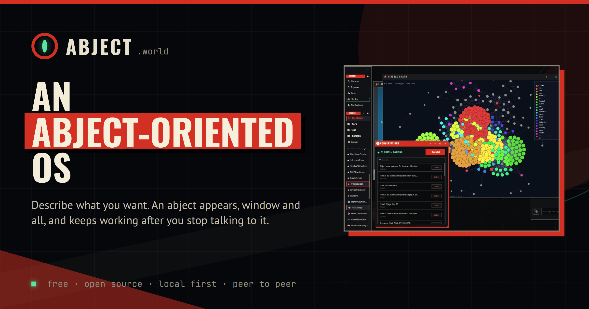
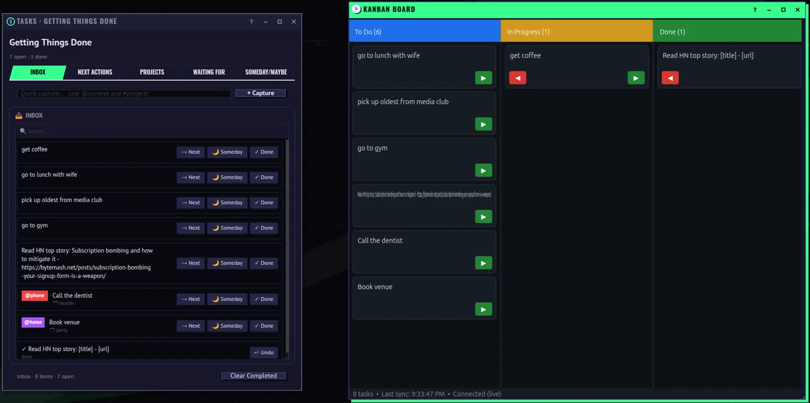
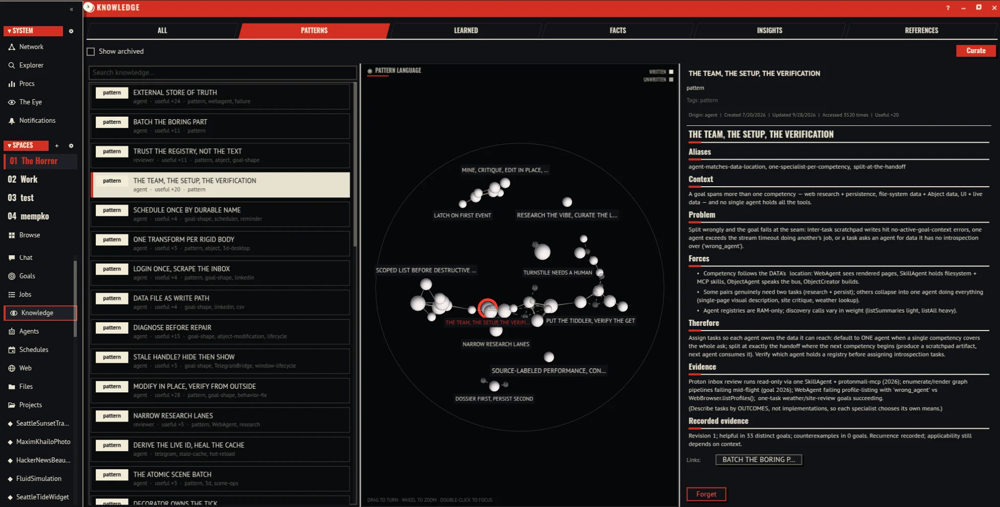

<p align="center">
  <a href="https://abject.world"></a>
</p>

<p align="center">
  <a href="https://github.com/mempko/abject/releases/latest"><b>Download</b></a> ·
  <a href="https://abject.world">abject.world</a> ·
  <a href="https://abject.world/install">Install guide</a> ·
  <a href="https://abject.world/why">Why Abject</a> ·
  <a href="https://abject.world/theory">The theory</a> ·
  <a href="https://abject.world/changelog">What's new</a>
</p>

# Abject: An Abject-Oriented OS

Describe what you want and an abject appears, window and all. It keeps
working after you stop talking to it, and it learns from every goal.

Abject is for anyone who wants software that's connected and personal to
them, and you don't need to know how to program. It's free, open source, and
it runs on your machine: Linux, Windows or macOS, or a server with no screen
at all.

> *abject (n.) 1. an AI object. 2. 'utterly hopeless'. Anyone who has
> maintained object-oriented code knows the two meanings are compatible.*

## The Big Idea: Every Abject Can Be Asked

Abject is short for AI Object. An abject is an object, a little computer that
sends and receives messages. Everything in the system is an abject: every
window and widget, every agent, the ScrumMaster that plans, the reviewer that
learns, the registry, the knowledge base, the link to your model, and whatever
you make next. An AI agent is just another abject. We don't need a special
protocol between agents and software, or between agents and agents. We just
need objects that can talk.

Every abject has a mandatory message handler called `ask`. You send it a
question in plain English and it answers in plain English, from its own
manifest and source code. Abjects describe themselves without anyone writing
documentation or schemas. The whole system is a bunch of objects sending each
other messages, Smalltalk or Erlang style, where each object has this ask
handler.

```
you> ask({ question: "what are you?" })

I'm an abject: a small object with a window, a mailbox and my own source
code. I handle messages like any other object, and when someone asks me
something, I answer in plain English. Like now.
```

The rest of Abject is built on that:

- **Make.** Before writing a new object, ObjectCreator learns how to use the objects it will depend on, mainly by asking them.
- **Team.** Before each sprint, the ScrumMaster asks each agent whether it can help. They answer or pass.
- **Find.** Agents find the right object by asking the registry: is there an object that handles this?
- **Connect.** When two objects don't speak the same messages, the ProxyGenerator asks both of them and writes a proxy that sits between them.

Ordinary messages never touch an LLM: they are typed payloads on a message
bus, fast and deterministic. The LLM is a service an abject calls when it
actually needs to think. [The Ask Protocol](https://abject.world/ask-protocol)
goes deeper.

## 1. Say It, and It's Running

Describe what you want in plain English and a real object appears on the
desktop. It has a window, a mailbox and its own source code, and it keeps
working after you close the chat. You never have to look at the code, but
it's there if you want to.

Things I asked for, and what stayed on the desktop:

| I asked for | What stayed on the desktop |
|-------------|----------------------------|
| "Show me the Sun, the Earth, and the Moon, live, and keep it fresh." | A NASA viewer streaming the Sun and the Earth, refreshing itself every minute. |
| A task list, then a Kanban board over the same tasks. | Two windows on one set of tasks: inbox, next actions and projects on one side; To Do, In Progress and Done on the other, kept in sync. |
| A client for my TiddlyWiki, so I can explore ten years of notes as a graph. | A graph of 474 notes and 14,615 links, clustered by tag. I didn't have to switch to Obsidian to get it. |
| "When is low tide in Seattle tomorrow?" | The answer came with a live NOAA tide widget, and the widget stayed on the desktop. |



It can look like anything. Abjects draw in 3D inside their windows, with
materials like gold, chrome, glass, ceramic, neon or hologram, each one a
single word, and you never write a shader. The desktop spreads its windows
into Exposé, each space has its own colors, and you (and your abjects) can add
new widgets, materials, looks and window effects.

## 2. A Team That Asks, Plans and Replans

You describe the goal: what you want, not how to get it. A team of agents
works on it in sprints, like Scrum. They agree on who does what, and each task
completes or fails. Then the ScrumMaster reviews what happened and the team
plans the next sprint, learning from what failed. Rinse and repeat until the
goal is done. The agents are abjects too.

- **Asked, not assumed.** Each agent is asked what it can do for the goal, and it answers or passes. The ScrumMaster assigns the tasks from the answers. A one-step request skips the ceremony and goes straight to the agent that can do it.
- **Failures count.** A sprint ends when its tasks finish or fail. The ScrumMaster reviews what really happened, including what failed, and decides to stop or run another sprint. There is no fixed retry budget, and a GoalObserver watches from outside so a goal that stops making progress is failed instead of left hanging.
- **Plans change.** Finding something new in the middle of a task isn't a defect in the plan, it's expected. An agent can replan: it says what it found and asks the others what should change. You can change course too: send a note while the goal runs and the next plan takes it in.
- **Goals outlive the machine.** In a shared workspace, goals sync across your peers, so a goal survives the machine it started on.

## 3. It Gets Smarter Every Time

Learning happens when things go wrong. For each task, the agent predicts what
the result should be. After the goal, a reviewer compares every prediction
with what actually happened and saves the lessons as facts and named patterns
in a knowledge base. The next plan starts from those patterns. The lessons
don't evaporate when the goal ends.

1. **Predict.** Before it acts, the agent writes down what it expects to happen.
2. **Act.** The runtime keeps the prediction and pairs it with what actually came back.
3. **Compare.** After the goal, the reviewer checks each prediction: supported, contradicted or unresolved. The misses matter most.
4. **Learn.** Lessons become facts. A problem that keeps coming back, goal after goal, becomes a named pattern.
5. **Weave.** For the next task, the patterns that fit, and the ones they link to, go into the agent's prompt and the ScrumMaster's plan.

The patterns are written the way Christopher Alexander and James Coplien wrote
theirs: each names a problem that occurs over and over, the forces that make
the obvious approach fail, and the resolution that keeps working, and each
links to the patterns that come next. Together they make a pattern language,
the part of the world model that generalizes. Here is a real one the reviewer
wrote:

> **The Team, the Setup, the Verification**
>
> *Context:* "A goal spans more than one competency … and no single agent holds all the tools."
>
> *Therefore:* "Assign tasks so each agent owns the data it can reach: default to ONE agent when a single competency covers the whole ask; split at exactly the handoff where the next competency begins…"
>
> *Recorded evidence:* "Revision 1; helpful in 33 distinct goals; counterexamples in 0 goals."



Once an LLM is deployed, its weights don't change, so on its own it can't
learn. An LLM with a harness and an external memory can. Here that memory is
something you can read: open the Knowledge window to browse the patterns, and
merge or prune them. It stays in its workspace, and a shared workspace syncs it
to its peers.

**A loop without memory is a treadmill. A loop with memory is a ratchet.**

## 4. Yours

- **On your machine.** Your abjects, what they learned and your chats live on your disk. No account, no telemetry, no subscription.
- **Any model.** A free local model through Ollama, an API key, or a coding CLI you already log into, from 14 providers: Ollama, PeerLLM, Claude Code CLI, Codex CLI, Antigravity CLI, Anthropic, OpenAI, Google Gemini, OpenRouter, DeepSeek, xAI Grok, Moonshot Kimi, MiniMax and Meta. Switch any time, and an abject can bring a provider of its own ([docs/LLM_PROVIDERS.md](docs/LLM_PROVIDERS.md)).
- **Across your devices.** Your machines talk to each other peer to peer, over encrypted WebRTC. Pair your phone with a QR code (Network → Frontends → Generate Pairing QR) and your desktop opens in its browser.
- **Contained.** Generated code runs in a locked-down sandbox with no access of its own to your files, the network or other processes. To touch anything outside, an abject has to ask the object that owns it, and a shell command, or a file outside the folders you allowed, stops at a prompt and waits for you. The horror is thematic. The containment is real.
- **Open source.** Free and open source under the GPL-3.0. Every abject carries its own source code, so you can open it and change it.

## Get Abject

The desktop app for Linux (AppImage, .deb), Windows and macOS (Apple silicon
and Intel) is on the [releases page](https://github.com/mempko/abject/releases/latest).
From download to your first abject takes about five minutes:

1. **Install.** Download the build for your machine and open it. The builds are not code-signed yet, so the OS pauses once; the [install guide](https://abject.world/install#first-launch) says what to click.
2. **Pick a model.** Settings opens by itself on the AI tab. Paste an API key, point it at Ollama, or choose a coding CLI you already log into.
3. **Ask for something.** Click Chat and describe what you want. A window appears. Close the chat and the window stays, still working.
4. **Say yes, or no.** The first time an abject wants a shell, a file outside its sandbox or a new website, it asks you first and waits.

The app keeps itself up to date (Settings → Updates). On macOS, where builds
are not signed yet, a new version is offered as a download instead.

On a server, or if you live in a terminal, install the headless edition: the
`abject` command with its own backend and no display.

```bash
curl -fsSL https://abject.world/install.sh | sh     # Linux and macOS
irm https://abject.world/install.ps1 | iex          # Windows (PowerShell)
abject                                              # guided setup the first time, then the chat
```

The release archives and a container image (`ghcr.io/mempko/abject`) carry the
same edition; [deploy/README.md](deploy/README.md) covers running it as a
service. To build from source, see [Running from Source](#running-from-source).

## Why I Built It

Most people never use a computer to compute. They read, watch, and scroll
inside sealed apps somebody else wrote, because software stayed hard to make
and making it stayed a profession. LLMs just cracked that open. Abject is
where that matters: anyone who can say what they want gets software that is
personal, connected, and theirs, running on their machine, under their
control, with nobody collecting rent.

Underneath is a blunt technical position: AI agents are the wrong
abstraction. Agent frameworks are hierarchies; MCP and A2A are plumbing
between things that shouldn't need plumbing. The abstraction that scales is
the one that already runs the world: objects passing messages (cells, the
internet). What was missing, and what LLMs finally provide, is a way for
objects to understand each other without rigid schemas.

The longform version lives on the blog:

- [An Abject Horror](https://blog.mempko.com/an-abject-horror/): the
  announcement. Why agents are the wrong abstraction, and what a
  self-aware object runtime is.
- [Entering the Architecture Age](https://blog.mempko.com/entering-the-architecture-age/):
  the software pyramid, the Window Tax, and why the big idea is messaging.
- [A Love Letter to Object Orientation](https://blog.mempko.com/a-love-letter-to-object-orientation/):
  why "the internet is an object-oriented system" is not a metaphor. Alan
  Kay's big idea was messaging, not classes.
- [Let the Information Monopolies Crumble!](https://blog.mempko.com/let-the-information-monopolies-crumble/):
  the human case. Computers are for computing, and everyone should get to.

On the site, [the theory](https://abject.world/theory) condenses them: the big
idea was messaging, compression instead of abstraction, the ultimate
metasystem, theory and artifact, and data, context and interaction.

## How It's Built

- **Everything is an Abject.** The registry is an abject. The factory is an abject. Even the thing that makes abjects is an abject. There is no privileged layer, just abjects passing messages.
- **Self-healing proxies.** When two abjects connect through a generated proxy, a health monitor watches the traffic. An error rate above 10% regenerates the proxy, and changing either side's source regenerates its proxies against the new interface. Break them. They grow back.
- **Containment.** Generated abjects run in a script sandbox with no file, network, or process access of their own. Code in other languages runs as WebAssembly, which can do nothing but send messages, log, and read the clock. No ambient authority: everything an abject does is a message to a capability object, and the ones that reach your machine or the network go through a permission broker that follows rules you set, or asks you.
- **True names.** Every peer has a true name: a SHA-256 hash of its public key. ECDSA/ECDH identity, AES-256-GCM encrypted WebRTC channels. Trust is verified, not assumed.
- **Nothing truly dies.** Erlang-style supervision with state snapshots. Kill an abject and it comes back knowing what it knew. Kill the worker thread it lived on and what lived there is rebuilt.
- **A body when it wants one.** An X11-style display server gives each abject a window with buttons, text inputs, layouts and custom drawing, and the client composites the windows in a WebGL scene. The headless edition has no display and works the same without it.

Every abject lives in a workspace, and workspaces decide who can see, who can
reach, and who can speak:

| Tier | Name | Behavior |
|------|------|----------|
| **Local** | The Sealed Vault | No routes exposed. Nothing enters. Nothing leaves. |
| **Shared** | The Inner Circle | Shared with the peers you name. Encrypted WebRTC, ECDH key agreement, AES-256-GCM. |
| **Public** | The Commons | Visible to all. Any peer can discover, connect, and begin the Ask Protocol. |

## Architecture

```
 ┌─ Node.js Backend (desktop: pnpm awaken / the app · headless: abject) ─┐
 │                                                                       │
 │  Main thread                                                          │
 │    MessageBus ── PeerRouter (remote traffic) · proxy routes           │
 │    Registry · Factory · Supervisor · AuthGate · Negotiator            │
 │    CliServer (:7723) · WebGateway (HTTP, off until enabled)           │
 │                                                                       │
 │  Worker pool (worker threads, one bus each)                           │
 │    LLM · capabilities · settings · ProxyGenerator · HealthMonitor     │
 │    workspaces · agents · Chat · KnowledgeBase (C++/WASM)              │
 │    your abjects (script sandbox, WASM) · windows (desktop only)       │
 │                                                                       │
 │  P2P worker                          UI worker (desktop only)         │
 │    Identity · PeerRegistry             BackendUI: the display server  │
 │    RemoteRegistry · PeerDiscovery                                     │
 └──────┬──────────────────────────┬─────────────────────┬───────────────┘
        │ WS :7719 (desktop)       │ WS :7723            │ WebRTC
 ┌──────▼─────────────────┐ ┌──────▼─────────┐ ┌─────────▼───────────────┐
 │ Thin browser client    │ │ abject         │ │ Peers, paired phones    │
 │ WebGL compositor, input│ │ (terminal)     │ │ (introduced by whisper) │
 └────────────────────────┘ └────────────────┘ └─────────────────────────┘
```

[ARCHITECTURE.md](ARCHITECTURE.md) walks through the layers, the boot
sequence and the main flows.

## Capability Objects

| Object | What It Does |
|--------|-------------|
| **HttpClient** | HTTP requests with domain allow/deny; private and loopback addresses only when you list them under Private hosts |
| **StreamClient** | Long-lived WebSocket and Server-Sent Events connections |
| **Storage** | Persistent key-value store (SQLite), one per workspace plus one global |
| **FileSystem** | A virtual filesystem per workspace |
| **HostFileSystem** | Real files on your machine, through the permission broker |
| **ShellExecutor** | Shell commands on your machine, through the permission broker |
| **WebSearch** / **WebFetch** | Web search, and a page's readable text |
| **WebBrowser** | Browser automation with Playwright (in the desktop app, Electron's own Chromium) |
| **WebParser** | HTML parsing and content extraction (linkedom) |
| **SharedState** | CRDT state that syncs with peers who share the workspace |
| **FileTransfer** / **MediaStream** | Files and media tracks over peer connections |
| **Timer** / **Clipboard** / **Console** / **Crypto** | Timers, the clipboard, per-object logs, hashing and secure randomness |
| **Screenshot** / **AudioOutput** / **Speech** | Desktop only: captures, sound, text to speech and back |

## Running from Source

### Prerequisites

- **Node.js 22.8+** (the server uses `node:sqlite`, and its code sandbox needs 22.8). Download from [nodejs.org](https://nodejs.org) or use [nvm](https://github.com/nvm-sh/nvm) (`.nvmrc` pins 22).
- **pnpm** - install via `npm install -g pnpm` or see [pnpm.io/installation](https://pnpm.io/installation) for other methods (Homebrew, Corepack, standalone script, etc.).

### Setup

```bash
# Clone the repository
git clone https://github.com/mempko/abject
cd abject

# Install dependencies
pnpm conjure

# Start the backend server (Node.js + worker threads)
pnpm awaken                     # ws://localhost:7719

# Start the browser client (new terminal)
pnpm scry                       # http://localhost:5174

# Start a local signaling server (optional, signal.abject.world is used by default)
pnpm whisper                    # :7720

# Chat with the system from your terminal (optional, waits for awaken)
pnpm abject                     # connects to ws://localhost:7723

# Or run with no display at all: the headless edition
pnpm awaken:headless            # then pnpm abject in another terminal
```

| Command | What it does |
|---------|-------------|
| `pnpm conjure` | Install dependencies (`pnpm install`) |
| `pnpm awaken` | Start the Node.js backend where all abjects live |
| `pnpm scry` | Start the thin browser client (Canvas UI over WebSocket) |
| `pnpm whisper` | Start a local signaling server (optional, `signal.abject.world` is used by default) |
| `pnpm abject` | The `abject` command: chat with your abjects from a tabbed TUI, answer their questions, change settings |
| `pnpm awaken:headless` | Start the headless edition: the same backend with no display |
| `pnpm incarnate:headless` | Package the headless edition (the `abject` binary and its backend, nothing to install); see [deploy/README.md](deploy/README.md) |
| `pnpm incarnate:server` | Package the desktop edition for a server: the same command and layout, with the whole desktop, opened from browsers by pairing; see [deploy/README.md](deploy/README.md) |

Three processes. One living system.

A few more, for working on it:

| Command | What it does |
|---------|-------------|
| `pnpm abject start` | Start the headless edition from source in the background (`pnpm abject stop` stops it) |
| `pnpm divine` | The browser client in peer-to-peer mode (what `client.abject.world` serves), on :5180 |
| `pnpm forge <dir>` | Build and install an abject package, WASM or script ([docs/PACKAGES.md](docs/PACKAGES.md)) |
| `pnpm smelt` | Rebuild the bundled C++ KnowledgeBase (`native/knowledge-base`) |
| `pnpm typecheck` | Type-check the whole tree |
| `pnpm test` | Run the test suite (`node:test`) |

## The abject Command

The desktop has a canvas; the terminal gets `abject`. It is a whole way to
run Abject, not only a view: the headless edition is the same backend with
no display, and `abject` starts it in the background, walks you through
setup the first time (where data lives, a model, what agents may do without
asking, an optional login, web browsing, starting at login), and connects.
Quitting the chat leaves the backend running so goals keep going;
`abject stop` stops it and `abject service install` starts it at login.
When the desktop app is running, `abject` talks to it instead (the app ships
its own copy, Help → Install the abject Command), and both share one data
directory, so the workspaces are the same either way.

The chat mirrors the desktop's: one tab per open chat, across every
workspace at once. Chats opened in the GUI appear as tabs live; goals render
as a panel with the task list and per-agent activity; questions from agents
(permission prompts, confirmations) and toasts reach the terminal, and
answering a question in either place resolves it in both. A question waits
until someone answers it: `/questions` in the chat, or `abject questions`
and `abject answer N <choice>` from any shell. For a machine nobody watches,
`abject mode allow|deny` answers requests no rule covers. Markdown renders
as terminal styling.

Keys are tmux-safe chords: `Ctrl+A` then `c` (open chat picker), `n`/`p`
or arrows (switch tab), `1`-`9` (jump), `x` (close tab), `w` (list),
`d` (quit). `Ctrl+A Ctrl+A` jumps to line start; set `ABJECT_PREFIX` to
rebind. Every action also exists as a slash command (`/help` lists them),
and `--plain` gives a line-oriented REPL for pipes and dumb terminals.
`abject help` lists the commands (`status`, `logs`, `setup`, `doctor`,
`update`, `settings get|set`, `serve`, ...).

Settings work from the terminal too. `/settings` opens every setting the
Settings window has (AI keys and tiers, login, permissions, filesystem,
shell, web) plus the current workspace's (name, access, web
exposure, theme): arrow to one, press Enter, type the new value. Keys and
passwords are hidden as you type and never shown again. The same changes
are one-liners for scripts and `--plain` (a tier set to `latest` follows the
provider's newest model):

```
/get shell                          /set shell.enabled off
/set ai.credentials.anthropic sk-…  /set ai.tiers.smart anthropic latest
/add web.allowedDomains example.com /wset appearance.theme agitprop
/preset apply OpenAI recommended    /skill enable <name>      /update check
```

Changes go through the same abject that serves the Settings window, so the
window repaints when the terminal changes something and the other way
round.

On the same machine, `abject` gets in with the owner token the backend
writes into its data directory. From elsewhere (`abject --url
ws://host:7723`, through an SSH tunnel), it asks for the login set in
settings and shares the browser client's session tokens. The one-line
installers above put it on your PATH; `abject update` moves an install made
that way to the newest release, and `abject doctor` checks it.

## Building the Desktop App

Package Abject as a standalone desktop app for Linux, Windows, or macOS.

```bash
# Build desktop app for your platform
pnpm incarnate:linux    # AppImage, .deb
pnpm incarnate:win      # NSIS installer
pnpm incarnate:mac      # .dmg, .zip (Apple silicon and Intel)

# Build for all platforms
pnpm incarnate:all
```

| Command | What it does |
|---------|-------------|
| `pnpm incarnate:<platform>` | Package as a standalone Electron desktop app |
| `pnpm bind` | Compile the server bundles only (desktop and headless; the build fails if display code reaches a headless bundle) |
| `pnpm etch` | Compile the client bundle only |
| `pnpm distill` | Bundle the `abject` command (`dist-cli/abject.mjs`), which the desktop app and the headless edition both ship |

Requires Electron. The app runs the backend inside Electron's main process,
opens the client in a window, uses Electron's own Chromium for web browsing,
and carries the `abject` command. node-datachannel and node-pty are native
modules, so the release workflow builds each platform on its own runner.

The **backend** is the depths: all abjects live here, passing messages in a
Node.js process with worker threads. The **browser client** is the surface: a
thin renderer that draws what the backend tells it to and sends input back
over WebSocket. The **signaling server** introduces peers to each other; it
never sees a byte of the conversation. The headless edition is the depths
alone, reached through `abject`.

For running the signaling server in production behind TLS, and pairing it with a
TURN relay so peers behind symmetric NAT or cell networks can still connect, see
[WHISPER.md](WHISPER.md).

## Configuration

| Variable | Default | Description |
|----------|---------|-------------|
| `ANTHROPIC_API_KEY` / `OPENAI_API_KEY` | - | Model keys read at boot (optional; `TYPESAFE_API_KEY` for the TypeSafe decision model too) |
| `ABJECTS_DATA_DIR` | `.abjects` or the OS location | Where the instance keeps its data. A source checkout uses `.abjects`; the desktop app and an installed headless edition use `~/.config/abject` (Linux), `~/Library/Application Support/abject` (macOS) or `%APPDATA%\abject` (Windows), so both see the same workspaces. One backend per data directory |
| `WS_PORT` | `7719` | The browser UI socket on a desktop; `GET /healthz` and `GET /version` on both editions (loopback) |
| `CLI_PORT` / `CLI_BIND` | `WS_PORT+4` / `127.0.0.1` | The gateway `abject` connects to. Bind it wider only with a login set |
| `HTTP_PORT` / `HTTP_BIND` | `WS_PORT+5` / `127.0.0.1` | The HTTP gateway's port and address, when it is enabled (see [docs/WEB_GATEWAY.md](docs/WEB_GATEWAY.md)) |
| `ABJECTS_AUTH_USER` / `ABJECTS_AUTH_PASSWORD` | - | A login for every socket (both or neither); also set in Settings or `abject setup`. A terminal on the same machine gets in with the owner token in `<data dir>/instance.json` |
| `ABJECTS_WORKER_COUNT` | CPU cores - 1 (max 8) | Worker thread pool size (`0` turns the pool off) |
| `ABJECTS_WORKER_MAX_OLD_SPACE_MB` | sized from memory | Heap ceiling per worker (default: three quarters of memory less 512 MB, shared across workers, 512 MB to 8 GB; in the desktop app, where every thread shares one ~4 GB heap, about 1.6 GB) |
| `ABJECTS_DEDICATED_WORKERS` | on | `0` keeps the peer layer and the display server on the main thread |
| `ABJECTS_PACKAGE_DIRS` | - | Extra package directories ([docs/PACKAGES.md](docs/PACKAGES.md)) |
| `ABJECTS_ALLOWED_ORIGINS` | - | Web pages allowed to open the UI WebSocket besides the desktop app and the dev client (`http://127.0.0.1:VITE_CLIENT_PORT`, default 5174), comma-separated, e.g. `https://abject.example.com` for a client served through a reverse proxy that forwards `/ws`. Pages of any other origin are refused; the CLI gateway refuses all pages |
| `ABJECTS_SIGNALING_URLS` | - | Use only these signaling servers (comma-separated `ws://`/`wss://`); servers learned from peers and the public default are never used (see [WHISPER.md](WHISPER.md)) |
| `ABJECTS_PEER_ADMISSION` | `open` | `allowlist`: connect only with allowed peers (Network → Servers & Peers → Who Can Connect, or `ABJECTS_ALLOWED_PEERS`) |
| `ABJECTS_ALLOWED_PEERS` | - | Peer IDs always allowed to connect (comma-separated) |
| `ABJECT_PREFIX` | `ctrl+a` | The `abject` chat's chord prefix |

Keys and model tiers are usually set at runtime: Settings → AI on the
desktop, `abject setup` or `/set ai.credentials.<provider>` in a terminal.
[deploy/abject.env.example](deploy/abject.env.example) lists the variables a
service needs.

Beside the environment, the data directory holds `packages.json` (packages and
their settings, [docs/PACKAGES.md](docs/PACKAGES.md)) and `profiles.json`
(workspace profiles, [docs/WORKSPACE_PROFILES.md](docs/WORKSPACE_PROFILES.md)).

The signaling server and its optional TURN relay have their own environment
(`SIGNALING_PORT`, `TURN_SECRET`, `TURN_URLS`, ...) and deployment guide in
[WHISPER.md](WHISPER.md).

### Using with Ollama (Local LLM)

Abject works with [Ollama](https://ollama.com) for fully local, private AI. Pull a
model per tier, sized to your machine, for example:

```bash
ollama pull qwen3:32b     # Smart tier (complex reasoning, code generation)
ollama pull qwen3:8b      # Balanced tier (general purpose)
ollama pull qwen3:4b      # Fast tier (quick tasks, low latency)
```

Leave Ollama running; Abject finds it at `http://localhost:11434`. Then pick
the models in Settings:
1. Click the gear in the System section of the dock to open Settings, AI tab
2. On the **Providers** sub-tab, Ollama shows as running. Press **Manage**, then **Use for every tier**
   (to reach Ollama on another machine, enter its address there first and press **Connect**)
3. On the **Models** sub-tab, change any tier (Smart, Balanced, Fast, and Code) to the model you pulled for it.
   Each change saves as you make it

From a terminal the same is `abject setup`, or one tier at a time:
`/set ai.tiers.smart ollama qwen3:32b`.

The tier system lets Abject pick the right model for each task: heavy reasoning uses the smart tier, routine work uses balanced, quick lookups use fast, and agents draft source code on the code tier.

## Working on Abject

Every directory has a `README.md` that says what is in it and how it fits
together; [ARCHITECTURE.md](ARCHITECTURE.md) walks the whole system, and
[PHILOSOPHY.md](PHILOSOPHY.md) holds the principles. You can also extend an
instance without touching the server: script packages in TypeScript or
JavaScript, and abjects in any language that compiles to WebAssembly (a C++
SDK is included), installed with `pnpm forge` ([docs/PACKAGES.md](docs/PACKAGES.md),
[docs/WASM_ABI.md](docs/WASM_ABI.md), [examples/](examples/)).

### Project Structure

```
src/
  core/                 # Types, contracts, messages, the Abject base class
  runtime/              # MessageBus, Mailbox, Supervisor, worker pool and bridges
  objects/              # System objects: Registry, Factory, LLM, agents, goals, chat, workspaces, settings, windows
  objects/capabilities/ # HttpClient, Storage, FileSystem, ShellExecutor, WebBrowser, SharedState, ...
  objects/widgets/      # Canvas UI toolkit: windows, layouts, buttons, text, tables, charts, markdown
  protocol/             # Negotiator, agreements, HealthMonitor
  llm/                  # Provider interface and providers (Anthropic, OpenAI, Ollama, OpenRouter, CLI-driven, ...)
  network/              # Transports, PeerTransport, SignalingClient, PeerRouter, binary wire codec
  sandbox/              # Packages (WASM and script): discovery, packages.json, ingest; the WASM host
  ui/                   # The WebGL compositor and 3D scene the browser client draws with
server/                 # Backend: shared boot (boot.ts), desktop and headless entries, display server, gateways, whisper
workers/                # Worker thread entries (pool, P2P, UI) and their constructor tables
client/                 # Thin browser client: FrontendClient, transports, pairing
cli/                    # The abject command: chat TUI, setup, service, update, doctor
electron/               # The desktop app (Electron main process)
native/                 # Bundled WASM system packages (the C++ KnowledgeBase)
sdk/cpp/                # C++ SDK for writing abjects that compile to WebAssembly
sdk/script/             # TypeScript types for script packages
examples/               # User-loadable abject packages, WASM and script (install with pnpm forge)
docs/                   # Specifications (PACKAGES.md, WASM_ABI.md, LLM_PROVIDERS.md, WEB_GATEWAY.md, ...)
deploy/                 # Running the headless edition as a service (systemd unit, environment file)
packaging/              # Package-manager manifests for the abject command
scripts/                # forge, headless packaging, the single-binary bootstrap
site/                   # abject.world
```

### Design by Contract

Correctness over performance. Abjects state their preconditions,
postconditions and invariants with `require`, `ensure` and `invariant` from
`src/core/contracts.ts`. They are never disabled. From `server/auth-gate.ts`,
the object that holds the login every socket checks:

```typescript
this.on('updateAuth', async (msg: AbjectMessage) => {
  contractRequire(await this.isBuiltInCaller(msg.routing.from, AUTH_WRITERS as readonly string[]),
    'AuthGate takes login changes from SettingsManager only');
  // ...
  contractRequire(!enabled || ((username as string) !== '' && (password as string) !== ''),
    'a login needs a username and a password');
  // ... apply the change ...
  this.checkInvariants();
});

protected override checkInvariants(): void {
  super.checkInvariants();
  invariant(!this.authConfig.enabled || (this.authConfig.username !== '' && this.authConfig.password !== ''),
    'AuthGate: login enabled without credentials');
}
```

## From the Ashes of Fire★

> Abject grew from the ashes of **Fire★** (firestr.com), a peer-to-peer
> platform for creating and sharing distributed applications. Fire★ called it
> **Grass Computing**: software you can touch, shape, and share directly.
> No cloud. No landlords. Fire★ proved the vision. But it dreamed in C++ and Lua.
>
> Abject is the next incarnation. The same soul in a new body.
> The grass still grows. Now it thinks.

| Fire★ | Abject |
|-------|---------|
| C++ / Qt / Lua | TypeScript / WASM / Canvas |
| RSA 4096 | ECDSA/ECDH + AES-256-GCM |
| Manual app sharing | LLM-mediated protocol negotiation |
| firelocator | Signaling server |

See [PHILOSOPHY.md](PHILOSOPHY.md) for the principles that carry the fire forward.

## License

GPL-3.0-or-later. See [LICENSE](LICENSE) for details.
